# Robot_arm: teaching a humanoid robot to stack cups and throw a cap, from phone videos


## Overview

This project teaches a humanoid robot a two-part table-top task from phone videos of a person doing it:

1. pick up three upside-down cups and stack them into a small pyramid: two cups side by side at the bottom (cup A
   and cup B), and a third cup turned over and placed on top of them, and
2. pick up a bottle cap and throw it into the top cup,

**without knocking the pyramid over or the robot falling**.

The robot is a **Unitree G1** humanoid simulated in **MuJoCo**, with a 5-finger **Shadow hand** (a 3-finger
Dex3 hand was tried first). Nothing is programmed by hand in the final controllers: they learn from examples.

How it works, in short:

- **Record.** I filmed myself doing each part of the task with a phone, with a printed marker sheet on the table.
- **Track.** Computer vision finds my hand, fingers and arm, the cups and the cap in every frame, and turns them
  into 3D positions on the table.
- **Retarget.** Two experts turn my movements into movements the robot can do (one for placing cups, one for the
  throw), and run them in the simulator on thousands of random cup layouts. The successful runs become the
  dataset.
- **Learn.** The robot's controllers learn from that dataset by copying (imitation learning, diffusion policy),
  then improve by practice (reinforcement learning, PPO).
- **Make it realistic.** Real-world hardware limits (motor strength and heat, balance, delays, camera errors) are
  added to the simulator to see whether the same approach would survive on a real robot.

**Where it stands:** in a perfect simulator, the 5-finger G1 completes the whole task in **59%** of new layouts.
With real-world limits it places the bottom cups reliably but rarely gets the top cup and the throw right, and has
not yet completed the whole task. Nothing has been run on a real robot yet.

## Features

- **Phone video to robot demos:** a marker sheet calibrates the camera; the camera may be fixed or handheld
  (frames are stabilised onto the sheet).
- **Hand, arm and object tracking:** MediaPipe (hands and fingers), RTMW (shoulder, elbow, wrist; shown in the
  side-by-side videos), ArUco markers and colour (cups and cap), and a ballistic fit of the cap's flight.
- **Retargeting experts:** a place expert that follows the human hand's path, and a throw expert that copies the
  human's throw style, both adapted to what the G1 can do.
- **Dataset generation:** many layouts in parallel, task mix, noise injection (DART) for recovery examples,
  only successful stages kept, and DAgger for extra data.
- **Several learned controllers:** behavior cloning, a chunked MLP, a diffusion policy and PPO fine-tuning;
  a vision-language-action model (SmolVLA + RL) in progress.
- **Two hands:** the Dex3 (3 fingers) and the Shadow hand (5 fingers), switched with `G1_HAND`.
- **Real-world hardware limits mode** (`G1_REAL=1`): torque and speed limits, gravity, motor heat, balance on the
  robot's own feet, hand weight, delays, camera and encoder noise, and per-try randomisation.
- **Evaluation and videos:** success rates on unseen layouts, a video of every try (`TRY_VIDEOS`), and a live
  browser view of many tries at once.
- **Tests** against synthetic ground truth.

## System architecture

### 1. Data collection and creation

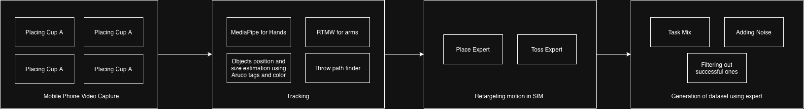

1. **Phone video capture.** I filmed myself doing each part of the task (placing cup A, cup B, turning over and
   placing the top cup, throwing the cap) with a phone, over three sets of videos (see
   [How I collected the dataset](#how-i-collected-the-dataset)).
2. **Tracking.** Each video is turned into numbers:
   - **MediaPipe** finds the hand and finger landmarks;
   - **RTMW** (whole-body pose) finds the shoulder, elbow and wrist. For now this is drawn in the side-by-side
     videos to check the tracking; the retargeting itself still follows the hand only;
   - **ArUco tags and colour** give the table's position and each cup's position and size;
   - the **throw path finder** fits a ballistic arc to the cap's positions in the video, which gives where it
     was let go, how fast, and how long it flew.
3. **Retargeting in the simulator.** Two experts turn the tracked movement into robot movement:
   - the **Place expert** follows my hand's path, placed relative to the cup it picks up and to where the cup goes
     down, scaled to the robot's arm, and adjusted to what the robot can do (approach along the fingers, stay
     above other cups, turn the top cup over the robot's way);
   - the **Toss expert** does the pinch and throw the robot's way, but copies my throw's style (release point,
     flight time, wind-up), with the aim calibrated in simulation.
4. **Dataset generation.** The experts are run many times on random cup layouts:
   - **task mix**: half the runs are the whole task, the rest only placing or only throwing, so every part gets
     enough examples;
   - **adding noise**: small random pushes are added to the robot's movement (but not to the recorded actions),
     so the dataset also shows how to recover from mistakes;
   - **filtering**: only the parts of a run that succeeded are kept.

#### Retargeting examples: from my hand to the robot

Each video is tracked (hand, cups, cap, and the marker sheet that gives the table's position). My hand's path is
then mapped onto the robot's hand, relative to the cup it picks up and to where the cup is put down. Left: my
video with the tracking drawn on it. Right: the robot doing the same movement.

| Placing a bottom cup | Turning over and placing the top cup | Throwing the cap |
|---|---|---|
| 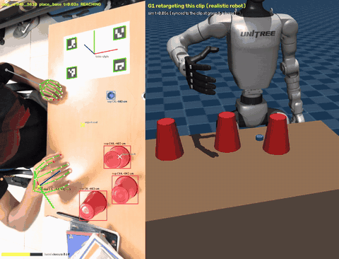 | 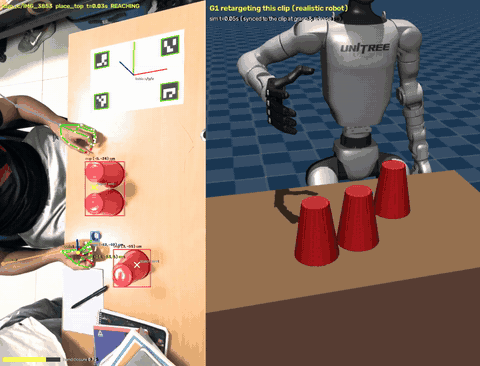 | 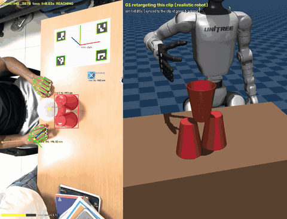 |

### 2. Training

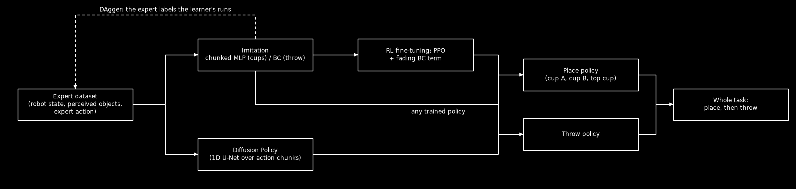

- **Input and output.** Each policy sees the robot's state (joints, hand, grip, which stage it is on) and the
  cups' and cap's positions as the robot's perception reports them. It outputs the hand's movement, turn and
  grip. There is one policy for placing (all three cups) and one for the throw; the whole task runs the place
  policy, then the throw policy.
- **Imitation.** First the policy copies the experts. For the cups, a chunked MLP predicts the next 16 moves and
  runs 8 before planning again, which avoids getting stuck on the expert's waits. For the throw, plain behavior
  cloning (BC). DAgger adds data: the learner drives, and the expert labels what it should have done.
- **Diffusion policy.** The same chunks, but drawn by a diffusion model (a 1D U-Net that removes noise from a
  chunk), which can choose one clean way out when several are possible. It is used as is, without the RL step.
- **RL (PPO).** Starts from the imitation policy and improves it by trial and error in many simulators at once,
  with a fading term that keeps it close to the demos so it doesn't forget them early on.
- **In progress: VLA.** A vision-language-action model (SmolVLA) that sees the robot's cameras and a spoken
  instruction per stage, with PPO adding a small correction on top.

## Repository structure

```
Robot_arm/
├── robot_arm/                  the Python package
│   ├── video/                  phone video → 3D: calibration, hand and object tracking, 3D lifting,
│   │                           stabilising handheld clips, splitting clips into skills
│   ├── humanoid/               the G1 cup pyramid
│   │   ├── scene.py, config.py     G1, hands, cups, cap and table in MuJoCo; task settings
│   │   ├── envs.py                 place / toss / full task environments (Gymnasium)
│   │   ├── hands.py, controller.py Dex3 and Shadow hands, inverse kinematics and grasps
│   │   ├── objects.py              pyramid geometry and success checks
│   │   ├── scripted.py             hand-written place and throw experts
│   │   ├── retarget.py             human demos → G1 (place tracker, throw styles, aim calibration)
│   │   ├── dataset.py              dataset generation (task mix, noise, DAgger)
│   │   ├── real.py                 real-world hardware limits (G1_REAL=1)
│   │   ├── evaluate.py, trylog.py  evaluation and per-try videos
│   │   └── vla.py, vla_model.py    vision-language-action model (in progress)
│   ├── bc.py, diffusion.py     behavior cloning; chunked MLP and diffusion policy
│   ├── ppo.py, policy.py       PPO fine-tuning; actor-critic network
│   ├── tasks.py                task registry used by training and evaluation
│   └── *.py (others)           the Panda ball-in-cup proof of concept
├── scripts/                    command-line entry points (g1_* for the humanoid, train_* for training)
├── tests/                      unit and end-to-end tests
├── docs/                       write-ups, recording guides, marker sheet, GIFs and diagrams
├── sim_videos/                 videos of the robot's tries, failures included
├── data/                       (not in git) videos, tracked landmarks, generated datasets
├── runs/                       (not in git) trained checkpoints
├── third_party/                (not in git) robot models, downloaded from MuJoCo Menagerie on first use
├── Dockerfile
└── pyproject.toml
```

## Installation

### Option 1: Python (pip)

Needs Python 3.10+ (tested on 3.12) and `git` (the robot models are downloaded from MuJoCo Menagerie the first
time they are used).

```bash
git clone https://github.com/ANGELOANTU7/Robot_arm.git
cd Robot_arm
python -m venv .venv && source .venv/bin/activate
pip install -e ".[dev,pose]"      # pose = RTMW arm tracking for the side-by-side videos; optional
pytest                            # check the install
```

Without a display (servers, containers), rendering needs `MUJOCO_GL=egl` (NVIDIA GPU) or `MUJOCO_GL=osmesa` (CPU).

### Option 2: Docker

```bash
docker build -t robot_arm .
docker run --rm -it robot_arm pytest                                          # check the image
docker run --rm -it robot_arm python scripts/g1_evaluate.py --task full --episodes 20
```

The default image uses CPU-only PyTorch. With an NVIDIA GPU (for training and faster rendering; needs the
NVIDIA Container Toolkit), build the CUDA version instead:

```bash
docker build --build-arg TORCH_INDEX=https://pypi.org/simple -t robot_arm:gpu .
docker run --rm -it --gpus all -e MUJOCO_GL=egl \
    -v "$PWD/data:/app/data" -v "$PWD/runs:/app/runs" robot_arm:gpu bash
```

The `-v` options keep your videos, datasets and trained models on your machine instead of inside the container.

## How to run

**Run the robot in simulation** with the hand-written experts (no training needed):

```bash
G1_HAND=shadow python scripts/g1_evaluate.py --task full --episodes 20          # success rate on new layouts
G1_HAND=shadow python scripts/g1_evaluate.py --task full --episodes 4 --videos runs/videos   # save mp4s
G1_HAND=shadow python scripts/g1_view.py --task full                            # watch it (needs a display)
G1_HAND=shadow G1_REAL=1 python scripts/g1_evaluate.py --task full --episodes 20   # with real-world limits
```

`--task` is `place`, `toss` or `full`; `--policy` takes `scripted` or trained checkpoints, e.g.
`--policy place=runs/place_chunk/policy.pt,toss=runs/toss_dp/policy.pt`.

**The whole pipeline from your own videos:**

```bash
export G1_HAND=shadow
# 1. Print the marker sheet (docs/marker_sheet.pdf, A4 at 100%) and record clips: docs/RECORDING_PYRAMID.md
# 2. Track the hands (MediaPipe), then the markers, cups and cap; folders map to skills
python scripts/g1_track_landmarks.py my_videos/*/*.MOV --out data/landmarks
python scripts/g1_process_videos.py my_videos/*/*.MOV --handheld --focal-px 880 --hands data/landmarks \
    --folders "cup_a=place_base,cup_b=place_base,cup_c=place_top,throw=toss" --second-cup cup_b \
    --out data/processed/human
# 3. Retarget onto the G1 and generate the dataset
python scripts/g1_retarget_demos.py --human data/processed/human --out data/processed/shadow --episodes 4000
# 4. Train: imitation (chunked MLP / BC), diffusion, then PPO
python scripts/train_diffusion.py --kind chunk_mlp --task g1-place --data data/processed/shadow/g1_place.npz \
    --out runs/place_chunk
python scripts/train_diffusion.py --task g1-toss --data data/processed/shadow/g1_toss.npz --out runs/toss_dp
python scripts/train_bc.py --task g1-toss --data data/processed/shadow/g1_toss.npz --out runs/toss_bc
python scripts/train_rl.py --init runs/toss_bc/policy.pt --demos data/processed/shadow/g1_toss.npz \
    --out runs/toss_ppo --num-envs 16
# 5. Evaluate
python scripts/g1_evaluate.py --task full --episodes 96 --policy place=runs/place_chunk/policy.pt,toss=runs/toss_dp/policy.pt
```

No videos? `python scripts/g1_make_synthetic_human.py --n 10` makes synthetic human clips to try steps 3–5 on.
All commands and options are in [docs/README_FULL.md](docs/README_FULL.md).

## How I collected the dataset

All videos were filmed on an iPhone with a printed marker sheet on the table, so the camera position and table
size can be worked out. The cups are red and the cap is blue, so they are easy to find by colour.

| Set | What it looked like | Problem | Result |
|---|---|---|---|
| **1st set** (32 clips) | Camera straight above the table | Only the hand was visible, and from straight above the height (z axis) of the hand and the cap could not be measured properly | Only 17 of 32 clips were usable, and just **1 throw** |
| **2nd set** | Improved camera setup | Tracking the hand while it moves fast (throwing) was still a problem | Worked better than the first set |
| **3rd set** (81 clips, `dataset_2`) | Camera tilted (~27°), with my **arm and shoulder in view** | — | The body (shoulders, elbows, wrists) can be tracked too, a first step towards the humanoid copying the arm, not only the hand |

Preview of each set, all showing the same action (turning over and placing the top cup, 1.5x speed):

| 1st set: straight above, only the hand | 2nd set | 3rd set: tilted, arm and body in view |
|---|---|---|
| 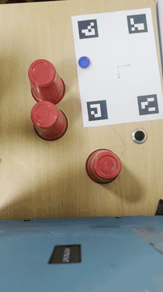 | *preview to be added* | 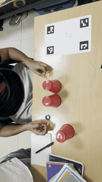 |

The 3rd set has 21 clips of placing cup A, 19 of cup B, 19 of the top cup and 22 throws. A hand was found in every
sampled frame, and the shoulders in 100% of frames.

## Simulating real-world hardware limits

A perfect simulator is too kind: motors are infinitely strong, the robot can't fall, and it knows exactly where
every object is. To see whether this could work on a real robot, real-world limits can be switched on with
`G1_REAL=1` (code in [robot_arm/humanoid/real.py](robot_arm/humanoid/real.py); `G1_REAL=clean` keeps the limits
but turns off the random parts).

| What was added | Default sim | With real limits |
|---|---|---|
| **Motor strength** | Very strong motors | Real torque limits from Unitree's G1 model (e.g. wrist 5 Nm, ankles and waist 35 Nm); torque drops near top speed |
| **Motor speed** | No speed limit | Joints kept below 85% of top speed and below 8 rad/s, so the arm doesn't whip the body |
| **Gravity** | Simulator holds the arm up for free | Motors must carry the arm's weight, like on the real robot |
| **Motor heat** | None | Each motor heats up with load; above 75 °C it gets weaker, at 90 °C it stops and the try fails (Unitree publishes no heat data, so these values are estimates) |
| **Balance** | Hips fixed in the air, the robot can't fall | Robot stands on its own feet and must balance; a fall ends the try |
| **Hand weight** | 0.69 kg | 1.8 kg, the real Shadow "Super Lite" hand |
| **Delays** | None | Commands arrive 0–30 ms late; the camera image is 50 ms old |
| **Camera errors** | Robot knows exact object positions | Objects are seen by a camera: ~3 mm calibration error, ~2 mm per object, ~1.5 mm jitter per frame, 3% of frames dropped |
| **Encoders** | Exact joint angles | Small noise on joint readings (0.002 rad) |
| **Changes every try** | Same robot every time | Motor stiffness ±20%, grip and object friction, cup and cap weight, joint friction, weaker battery (up to −10%), random pushes on the torso (~8 N) |

To cope with these, the hand-written expert (used to make the dataset) was also changed:

| Change in the controller | Why |
|---|---|
| Fingers open when the cap reaches the release point, not on a timer | With slower motors the arm lagged and the cap left too early, missing by ~10 cm |
| A held cup's position is updated from the hand's movement | The camera image is late, so the robot was steering the cup to where it used to be |
| Waits 3× longer to line up cup B before lowering it | Cup B came down before it was aligned |
| Rises straight up after placing a cup | Turning towards the next cup with the fingers still around it knocked the cup over |
| Waist moves slowly (0.5 rad/s), the arm does most of the reaching | Swinging the torso throws the robot off balance |
| Elbow pushed away from the body | The arm was passing through the robot's chest |
| Top cup placed at a fixed heading | Gave 11/48 successes instead of 5/48 |


## Results

All numbers are from the simulator. "Tries" are random layouts of cups and cap that the robot had not seen before.

### 1. Panda arm (ball in cup)

| Policy | Success | Speed |
|---|---|---|
| Copying the demos (behavior cloning) | 98% | 121 steps |
| Copying + practice (BC + PPO) | 98% | **80 steps** (1.5× faster) |

The idea works: the robot learns the task from demos, and practice makes it faster.

### 2. G1 with the 3-finger hand

| | Cup A | Cup B | Top cup | Throw | Whole task |
|---|---|---|---|---|---|
| Hand-written controller | 96% | 92% | 79% | 29% | 29% |
| Learned from my videos | 54% | 42% | 67% | 0% | **0%** |

Stacking was partly learned, but the robot never learned to throw: the 3-finger hand struggled to pick up the
small cap, and there was only one usable throw video.

### 3. G1 with the 5-finger hand

| | Result |
|---|---|
| Each cup on its own (A / B / top) | 32/32, 32/32, 31/32 |
| Pyramid built in a whole run | 85/96 (89%) |
| Throw alone, from a built pyramid | 67/96 (70%) |
| **Whole task done** | **57/96 (59%)** |

This was the best result. Later I found the arm was passing through the robot's own chest when placing the top
cup. After fixing that, the numbers dropped to: pyramid 69/96 (72%), throw alone 59/96 (61%), whole task 43/96
(45%).

### 4. With real-world hardware limits

First I tested the 5-finger models with real-world errors added. They broke quickly (cap in the cup, out of 48
tries):

| Condition | Cap in |
|---|---|
| Perfect simulator | 27 |
| 5 mm camera error | 6 |
| 50 ms delay | 3 |
| Softer motors | 2 |

Then I rebuilt the robot with real limits and retrained it:

- **Balance:** at first the robot fell over in 38 of 40 runs when it reached out; after fixes, 5 of 40.
- **Placing cups:** cup A 100%, cup B 56%, top cup 38%.
- **Throw:** 11.5% learned, 12.5% hand-written.
- **Whole task: 0 of 96** (the best of all tries was 1 of 96).

**Perfect sim vs real limits, side by side.** The same method (imitation learning) trained in each world, on the
same layout. In the perfect sim it builds the pyramid and lands the cap. With real limits it also builds the pyramid,
but as its hand leaves the top cup to start the throw, it catches the pyramid and knocks it down (2.5x speed; the
real-limits side keeps running 1.5 s after the failure so you can see it).

This run was picked to show a failure at the throw, which is rare: with real limits the robot built the pyramid in
only 7 of 208 layouts, and in 5 of those 7 it knocked the pyramid just as the throw started. Its balance is also weak:
on most layouts its hips move 4–5 cm and it fell over in about 1 run in 5. Both are among the main things a real
robot would need fixed.

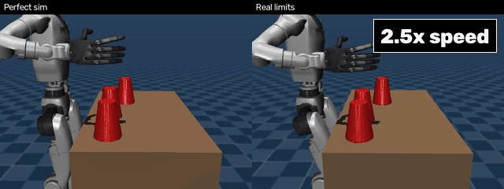

### 5. Learned controllers compared, per task

Two tables: one in the default (perfect) simulator, one with real-world limits on. Both use the 5-finger hand.

- **Imitation**: copies the robot demos made from my videos (a chunked MLP for the cups, BC for the throw).
- **RL (PPO)**: the imitation policy improved by trial and error.
- **Diffusion**: a diffusion policy.

Each row uses the same layout for every controller. The percentage under each GIF is its success rate over 48
tries (cups) or 96 tries (throw); the best in each row is in bold. The GIF shows one try, so it can succeed where
the percentage is low, or fail where it is high.

#### a) Default simulator (no real-world limits)

| Task | Imitation | RL (PPO) | Diffusion |
|---|---|---|---|
| **Cup A** | 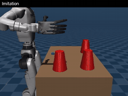<br/>**100%** | not trained | 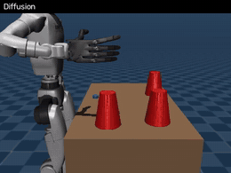<br/>**100%** |
| **Cup B** | 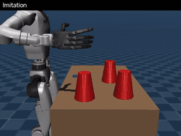<br/>**100%** | not trained | <br/>85% |
| **Top cup** (turn over + place) | 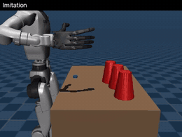<br/>**79%** | not trained | 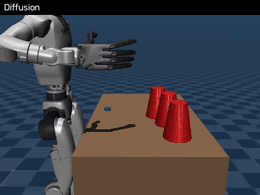<br/>44% |
| **Throw** | 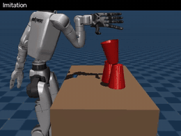<br/>40% | 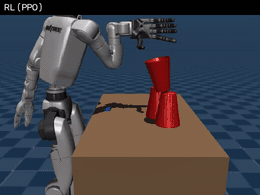<br/>52% | 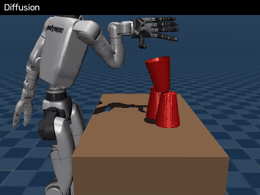<br/>**61%** |

In the default simulator imitation is best at placing cups. On the throw, RL and diffusion both improve on plain
imitation, and diffusion is best.

#### b) With real-world limits

Filmed from the front, so you can see whether the top cup sits in the middle. The success check accepts a top
cup up to 3 cm off-centre, so the top-cup row uses a layout where every success is centred (within 1 cm).

| Task | Imitation | RL (PPO) | Diffusion |
|---|---|---|---|
| **Cup A** | <br/>98% | 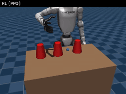<br/>**100%** | — |
| **Cup B** | 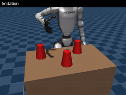<br/>**69%** | 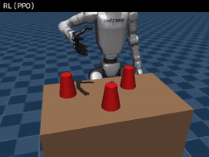<br/>52% | — |
| **Top cup** (turn over + place) | 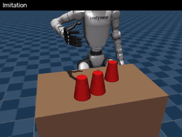<br/>**38%** | 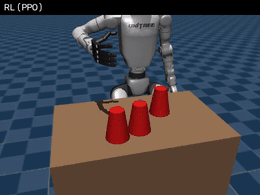<br/>35% | — |
| **Throw** | 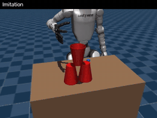<br/>5% | <br/>7% | 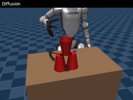<br/>**9%** |

With real limits, RL is best on cup A, imitation on cup B and the top cup, and diffusion on the throw. With 48
tries per cup task, gaps smaller than about 15–20 points could be chance; the largest is cup B (69% vs 52%).

### What this means

- The method works in a perfect simulator: **59% of whole runs** succeeded with the 5-finger hand.
- With real-world limits it does not work yet. The hardest parts are **placing the top cup** (it tips over when
  let go a little off-centre) and **the throw** (picking up the small cap and falling over while throwing).
- Nothing has been tested on a real robot yet.

## Methods tried

### 1. Panda arm: does the idea work at all?

Before trying a humanoid, I tested the whole pipeline on a simple task: a **Franka Panda** robot arm picks up a
ball and drops it into a cup. This showed that videos → robot movements → learning works end to end.

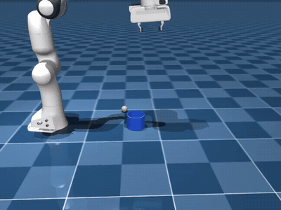

### 2. Unitree G1 humanoid with a 3-finger hand (Dex3)

Then I moved to the real task on a **Unitree G1** humanoid with its 3-finger Dex3 hand. Two steps were hard:

- **Turning the top cup over.** The cups start upside down, so the top cup has to be flipped in the air. With only
  three fingers, the opening fingers push the cup when it is let go.
- **Placing the top cup.** It often tipped over or fell into the gap between the two bottom cups.

| Hand-written controller, whole task (a success) | Learned policy on the top cup: knocks the pyramid |
|---|---|
| 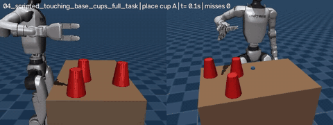 | 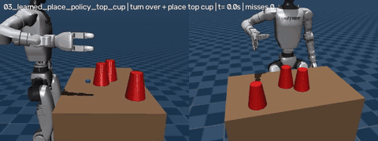 |

### 3. Unitree G1 with a 5-finger hand (Shadow hand)

I swapped the Dex3 for a 5-finger **Shadow Dexterous Hand**, holding the cups with the thumb and index finger
only, the same way I do in my videos. Stacking became much more reliable.

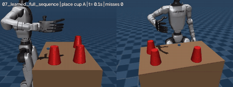

### 4. Simulating real-world hardware limits

Finally, the G1 with the 5-finger hand was rebuilt with real-world hardware limits (motor strength and heat,
balance, delays, camera errors) and retrained. See
[Simulating real-world hardware limits](#simulating-real-world-hardware-limits) for what was added and
[Results](#4-with-real-world-hardware-limits) for how it did.


## More detail

- [docs/README_FULL.md](docs/README_FULL.md): the full technical write-up (how each step works, all commands)
- [docs/DECISIONS_LOG.md](docs/DECISIONS_LOG.md): every problem and decision along the way
- [docs/RECORDING_PYRAMID.md](docs/RECORDING_PYRAMID.md): how to record your own videos
- [sim_videos/](sim_videos/README.md): videos of the robot's tries, failures included
