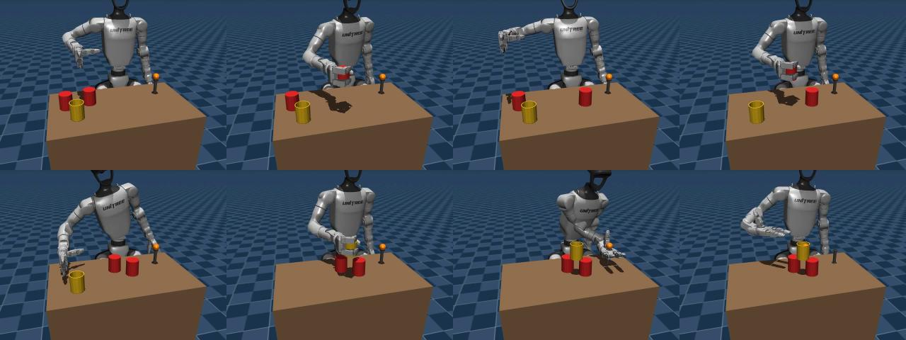
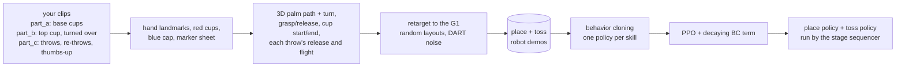
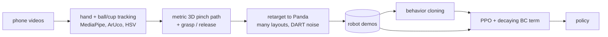
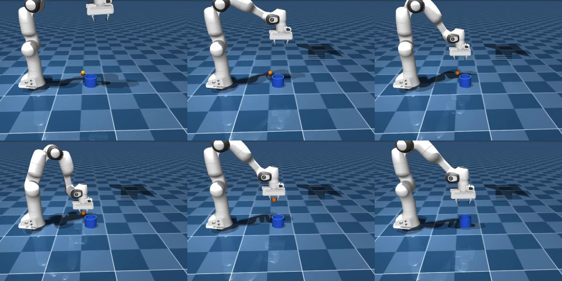

# Robot_arm: robots that learn cup tasks from your phone videos

Two tasks share one pipeline: phone videos of your hand → 3D human demonstrations → retargeting onto a robot
in **MuJoCo** → **behavior cloning** → **RL fine-tuning (PPO)**.

- **[Humanoid cup pyramid](#humanoid-cup-pyramid-unitree-g1)** (current). A **Unitree G1** with Dex3 hands
  builds a pyramid from three red party cups lying anywhere (turning the top one over in the air), throws a
  bottle cap into the top cup until it goes in, and shows a thumbs-up. It learns from your phone clips.
- **[Panda ball in cup](#panda-ball-in-cup-the-original-task)** (the original task). A **Franka Panda** picks up
  a ball and drops it into a cup.

## Humanoid cup pyramid (Unitree G1)



A **Unitree G1** (Dex3 three-finger hands, pelvis fixed, right hand only) is given three red party cups lying
mouth-down anywhere within reach and a blue bottle cap lying somewhere on the table. As in your clips, it:

1. puts two cups mouth-down side by side at a fixed spot in front of it (A, then B next to A);
2. picks up the third cup, **turns it over in the air with the same hand** and puts it mouth-up across A and B;
3. pinches the cap off the table and throws it into the top cup. **After a miss it picks the cap up wherever it
   landed and throws again**, aiming off by how far the last throw missed;
4. once the cap is in, **shows a thumbs-up** (fist, thumb pointing up, held for half a second).

An episode succeeds when the thumbs-up is shown with the cap in the top cup of a standing pyramid. The objects
match yours: cups 12 cm tall, 9 cm across the mouth, 5 cm across the bottom; a 2.8 cm cap.




### What is learned, and from what

The robot doesn't watch your videos at run time. It sees the simulator's state: joint angles, its hand pose,
each cup's position and mouth direction, the cap's position and velocity, the current stage and its target.
Your videos are turned into robot demonstrations before training.

| Part | How it is obtained |
|---|---|
| Where the cups and the cap are | Simulator state (on a real robot: a camera-based object tracker) |
| Which cup to move next and where it goes | Fixed sequencer: A → B next to A → top cup centred on A and B → throw (again after a miss) → thumbs-up. The top cup's target follows where A and B actually ended up |
| The hand's path when placing a cup: approach, carry, lowering, letting go, moving away | **Learned** (BC, then PPO) from your `part_a` and `part_b` clips, retargeted: your path relative to the cup you picked up and to where you put it down |
| How the hand turns while reaching | **Learned** from your palm's turn while reaching, relative to the grasp |
| Turning the top cup over | The robot's own way, shown in the demos it learns from: carried mouth-down to above the pyramid, rolled half a turn there and put down. Your clips decide when the hand starts moving and how the hand gets to the cup |
| When to close and open the hand | **Learned**. The demos close when the hand is around the cup and open when the cup stands, so the decision depends on the state, not the clock |
| The throw: release distance, height, flight time, wind-up | **Learned** from your `part_c` clips, clipped to the range where the G1's throw works; the aim is calibrated in simulation |
| Throwing again after a miss | **Learned** from demos in which the robot picks the cap up where it landed and aims off by how far the last throw missed (as you did in your clips with misses) |
| The thumbs-up | **Learned** from demos of the gesture after the cap is in; the hand shape (fist, thumb up) is the Dex3's own |
| Turning joint targets into torques | MuJoCo position actuators; the hand pose → joints step is damped least-squares IK |

### Quickstart (no videos needed)

```bash
pip install -e ".[dev]"
python scripts/g1_evaluate.py --task full --episodes 20       # scripted experts
python scripts/g1_view.py                                     # watch (needs a display)

# The whole learning pipeline on synthetic human clips:
python scripts/g1_make_synthetic_human.py --n 10              # -> data/processed/human_pyramid_synthetic/
python scripts/g1_retarget_demos.py --human data/processed/human_pyramid_synthetic   # -> g1_place.npz, g1_toss.npz
python scripts/train_bc.py --task g1-place --data data/processed/g1_place.npz --out runs/g1_place_bc \
    --epochs 60 --eval-every 20
python scripts/train_bc.py --task g1-toss --data data/processed/g1_toss.npz --out runs/g1_toss_bc \
    --epochs 150 --eval-every 50
PPO="--num-envs 8 --rollout-steps 512 --minibatch 2048 --actor-lr 2e-5 --target-kl 0.01 --bc-min 0.1"
python scripts/train_rl.py --init runs/g1_place_bc/policy.pt --demos data/processed/g1_place.npz \
    --out runs/g1_place_ppo $PPO --iterations 40 --init-std 0.05
python scripts/train_rl.py --init runs/g1_toss_bc/policy.pt --demos data/processed/g1_toss.npz \
    --out runs/g1_toss_ppo $PPO --iterations 30 --init-std 0.012 --min-log-std -4.8
python scripts/g1_results.py --replay data/processed/human_pyramid --episodes 40 \
    --bc runs/g1_place_bc/policy.pt runs/g1_toss_bc/policy.pt \
    --ppo runs/g1_place_ppo/policy.pt runs/g1_toss_ppo/policy.pt
```

### With your own videos

Record short clips following **[docs/RECORDING_PYRAMID.md](docs/RECORDING_PYRAMID.md)**: a fixed phone, the
marker sheet on the table, your red cups and the blue cap; clips of the base cups in `part_a/`, of the top cup in
`part_b/`, of the throws in `part_c/`. `scripts/upload_videos.py` sends such a folder to a cloud session through
a branch of this repository. Then:

```bash
python scripts/g1_process_videos.py data/videos_pyramid/part_c/IMG_3783.MOV --check          # markers + colors
python scripts/g1_process_videos.py data/videos_pyramid/*/*.MOV --focal-px 1740             # -> data/processed/human_pyramid/
python scripts/g1_retarget_demos.py --human data/processed/human_pyramid                      # then train as above
```

Clips filmed with the phone in your hand work too, as long as the marker sheet stays in view: `--handheld` warps
every frame onto one fixed camera using the sheet (`robot_arm/video/stabilize.py`). For the iPhone 16's 0.5x lens
filming 1920x1080, the focal length calibrates to about 880 px:

```bash
python scripts/g1_process_videos.py extra_dataset/cup_c/*.MOV extra_dataset/throw/*.MOV --handheld --focal-px 880 \
    --max-width 960 --folders "cup_c=place_top,throw=toss" --out data/processed/human_new
```

**Videos of every try.** With `TRY_VIDEOS=<folder>` set, every episode run by the evaluation, the dataset generation
and DAgger is saved there as `<name>_<seed>_<outcome>.mp4` (`robot_arm/humanoid/trylog.py`). Each recording worker
pins about 0.75 GB of GPU memory, so on a 16 GB machine keep it to 6 workers in all.

**DAgger.** `scripts/g1_dagger.py` runs the learned policy, has the retargeted expert label every state it visits,
and retrains on all the data so far. That is the usual remedy when a BC policy drifts off the demos and never
learned how to come back.

### How it works

**Video → human skill demonstration** (`robot_arm/video/skills.py`, `skill_process.py`, `cups.py`)
- *Camera.* The marker sheet gives the table frame. Your phone looked down at the table from about 66 cm, tilted
  about 5°; its focal length (1740 px at 1080×1920 for the iPhone 16 main camera at 1x) is passed in, since a
  sheet seen straight from above can't calibrate it.
- *Palm pose.* MediaPipe's world landmarks are metric and camera-aligned. The wrist and knuckles give the palm
  frame, and the camera pose turns it into the table frame. Finger curl and thumb distance give a closure value.
- *Same-colour cups.* All cups are red, so a moved cup is found from what changes: red only in the first (still)
  second is where it started, red only in the last second is where it went. A cup's spot is the circle of its
  rim on the table, fitted with the cup's known radius to the side of its outline facing the camera (the far
  side is hidden behind the wall). When a clip shows both base cups being put down, the two start spots and
  the two end spots are told apart by when each empties or fills, and the clip becomes one demo per cup
  (cup B's records where cup A stood).
- *Depth scale.* The hand's size (and so its depth) is fitted per clip from the grasp: the palm is beside the
  cup it closes on, or the thumb–index point is at the cap.
- *Throws.* Each throw is where the cap leaves the fingertips; the last one is the one that went in. From
  above, the flight is the straight stretch before the landing, and the release height is kept near the top
  cup's rim (a top-down camera barely sees heights). The top cup's opening is its white inside next to the
  pyramid's red; a cap that drops out of sight in it still counts as in.
- *Thumbs-up.* A fist with the thumb pointing up, after the cap is in.
- *Checks.* Demos whose reconstruction is unreliable are left out, with the reason printed: the hand far
  from the cup at the grasp, a depth scale at the edge of its search range, grasp and release not told
  apart, or a flight that couldn't be made out.

**Retargeting** (`robot_arm/humanoid/retarget.py`)
- *Placing.* Your hand path is mapped relative to the cup near the grasp and relative to the target near the
  release, turned to the robot's heading (towards the cup from its shoulder when grasping, forward when putting
  down) and scaled by the arm-length ratio. While reaching, the hand turns about the vertical as yours did. The
  robot's constraints come on top:
  - the approach slides in along the fingers;
  - the path clears the other cups;
  - only motion too fast for the arm is slowed down.
  A closed-loop tracker follows it and triggers the grasp, the final alignment, the lowering and the release
  from the state.
- *Turning the top cup over.* Once it holds the cup, the robot carries it mouth-down to above the pyramid, rolls
  the hand half a turn about its fingers' axis, puts the cup down a centimetre towards its palm (opening the
  hand pushes it away from the palm), lets go at once and leaves upwards along the cup's wall. The G1's arm
  can't roll a held cup anywhere along a human path, and where it lets go decides whether the pyramid stands.
- *Throwing.* Your throw's style becomes the robot's: release distance and height relative to the mouth,
  bearing off the base cups' line, flight time and wind-up. It is clipped to where the G1's throw works
  (`TOSS_BOUNDS`, from simulated sweeps: 10–16 cm from the mouth). The release velocity is ballistic for the
  robot's own release point, and the aim is calibrated per style in simulation. The pinch itself is the
  robot's own, as the Dex3 has three fingers and the cap needs millimetre placement.
- *Re-throws and the thumbs-up.* When the cap lies still outside the cup, the robot goes back for it and aims
  off by 0.8 of how far the last throw passed from the mouth. With the cap in, it turns its hand thumb-side up
  beside its shoulder and closes the fist.
- Rollouts get noise on the executed motion (DART) but not during contacts. Every stage that succeeds is kept.

**Learning.** One Gaussian MLP per skill (place: stages A, B and top; toss: throws and thumbs-up) is trained with
BC, upweighting the rare open/close steps and the fast throw steps. It is then fine-tuned with PPO plus a
decaying BC term on the skill's own environment. At run time the sequencer hands each stage to the right policy.
- *Reward.* Potential-based shaping: each step earns the change in staged progress (reach → hold → near the
  target → placed; held → thrown towards the mouth; thumb up and held), and success earns +10. An earlier
  version paid the progress itself every step. PPO found that holding a placed cup until the time ran out paid
  more than letting go, and took the place skill from 100% to 0% success while its return went up.
- *Exploration.* Small and fixed: a std of 0.05 action units for placing and 0.012 for the throw.

### Results

Your 32 clips → 17 usable demos (see the limits below) → retargeted rollouts → one policy per skill. Each cell
is 24 held-out layouts with the cups and the cap placed at random (`scripts/g1_results.py`, also written to
`runs/final/g1_results.md`). The full task counts only episodes that end with the thumbs-up, the cap in the top
cup and the pyramid standing. Everything ran in this container (4 CPU cores, no GPU).

| Policy | place A | place B | place top (turned over) | throw + thumbs-up | full task |
|---|---|---|---|---|---|
| Scripted experts (hand-written, not learned) | 96% | 92% | 79% | 29% | 29% |
| Your demos, retargeted and replayed (no learning) | 96% | 92% | 54% | 29% | 12% |
| BC (one policy per skill) | 54% | 42% | 67% | 0% | 0% (6 of 24 built the pyramid and reached the throw) |

- **Placing is learned from your clips; the throw is not.** BC places cup A, cup B and the turned-over top cup
  42–67% of the time. The throw policy never lands the cap: it rarely gets the millimetre-exact pinch on the
  cap, and only 58 successful throws (plus 222 from earlier runs) were there to learn from, all from a single
  usable throw clip.
- **PPO did not help this time.** A 20-iteration PPO run on the place skill (about 40 minutes) went from 67% to
  42% at its evaluations; its best checkpoint stayed the BC one, so there is no separate row. (In an earlier
  version, with the base cups 2 cm apart, 20 PPO iterations took the place skill from 62% to 79%.) PPO on the
  throw, starting from a policy that never succeeds, didn't get anywhere either.
- Missed throws are followed by re-throws, about 0.2–0.25 per episode. Most failed throws don't end in a clean
  miss but with the pyramid knocked (the cap landing on the top cup, or the fingers hitting the cups while
  picking up a cap that lies next to them), a cap rolling off the table, or a pinch that never closes on it.
- **Videos of the tries**, failures included: [`sim_videos/`](sim_videos/README.md).

### Simulation shortcuts and limits, stated plainly

- The pelvis is fixed: the legs stand still and only the waist, the right arm and the right hand move.
- Objects are tracked perfectly (the policy gets their state). A real robot needs a camera-based tracker.
- **Where things can lie.** The cups and the cap start anywhere in a region the right hand reaches well: 22–56 cm
  from the right shoulder, from 63° to its right to 46° to its left, on the table and at most 8 cm left of
  the robot's centre line, clear of the pyramid's spot and of the path the hand takes to each cup. Cups further
  left were pushed off the table by the approaching hand. The cap stays at least 20 cm from the pyramid and at
  most 42 cm in front of the robot (further forward the palm-down pinch is out of reach). Most layouts can't fit
  all four objects under these rules (measured: 85% for the Dex3, 72% for the Shadow hand's corridor and pyramid
  spot); those use the nominal spots moved by up to 3 cm, so the layouts vary less than "anywhere" suggests.
- **Turning the top cup over.** Letting go of a cup with the hand upside down is awkward for the Dex3: the
  opening fingers push the cup. The scripted expert puts it down about 1 cm towards its palm, snaps the hand
  open and leaves upwards along the cup's wall; with the base cups touching it succeeds in 83–88% of layouts.
  A placement only counts once the hand is clear of the cup, and for the top cup once it has stayed put for
  half a second.
- The cups' walls are 2 mm thick (real ones are about 0.5 mm) because thinner walls make contacts unreliable
  in simulation. Cup mass is 12 g and cap mass 2 g; measure yours and set them in
  `robot_arm/humanoid/config.py`.
- **The base cups touch** (2 mm apart), as in your pyramid, and the top cup rests across their bottoms' rims.
  An earlier version stood them 2 cm apart so the top cup would wedge into the V between them; when the top cup
  was let go of upside down it tipped into that V instead (top-cup placement 46% at 2 cm, 75% touching, 88% at
  2 mm). Thanks to you for spotting this.
- A top cup counts as standing if it rests within 3 cm of the base cups' midpoint, up to 6 cm lower than their
  tops, and tilts less than 20°.
- **The throw is the weak part.** The robot's throw works for releases 10–16 cm from the cup; your throws are
  pulled into that range (their arc and wind-up are kept, their distance is not). Even the scripted thrower lands
  the cap and shows the thumbs-up in only about a quarter of tries. The `sim_videos/` show why:
  - the 2.8 cm cap lying anywhere needs a millimetre-exact pinch, and from some spots the arm can't quite
    reach the pinch pose;
  - a throw that misses can roll off the table, which ends the episode;
  - a cap that lands on the top cup's rim or next to the pyramid is then picked up close to the cups, and the
    fingers knock them.
- **A five-fingered hand (in progress).** `G1_HAND=shadow` replaces the Dex3 with a Shadow Dexterous Hand on the
  G1's wrist, everywhere (envs, experts, evaluation, data, training). It holds the cups and the cap with **the
  thumb and the index finger only**, as in your clips. With it, the scripted experts put both base cups down
  (8/8 and 8/8). The cap pinch and the thumbs-up are designed, and turning the top cup over is being finished.
  Status, results and next steps: [docs/HANDOFF_FIVE_FINGER.md](docs/HANDOFF_FIVE_FINGER.md). The Dex3 stays
  the default.
- **What your clips gave.** 32 clips: 13 of the base cups (most showing both A and B), 10 of the top cup, 9 of
  throws. MediaPipe found the hand in only part of the frames of some clips (the hand is seen from above, often
  at the image's edge), and every demo whose reconstruction looked wrong was left out, with the reason printed by
  `g1_retarget_demos.py`. Of the demos that were reconstructed, those the robot never managed to reproduce when
  retargeted (3 layouts, no noise) were left out too. **Used for training: 7 demos of cup A, 4 of cup B, 5 of the
  top cup and 1 throw.** Most throws were dropped: the hand is hard to track while throwing, and seen from
  above the cap's flight is hard to make out. The robot's re-throws after a miss are its own (aimed off by the
  miss), as none of your clips with misses could be reconstructed reliably.
- Seen from straight above, a throw's height and flight are the least certain part of the reconstruction: the
  release height is taken near the top cup's rim, and the flight time from the cap's speed across the table.

## Panda ball in cup (the original task)

You record yourself picking up a small ball, moving it over a cup and dropping it in. This project turns those
clips into 3D hand trajectories, retargets them onto a **Franka Panda** arm in **MuJoCo**, trains a
**behavior-cloning** policy on the retargeted demonstrations, and then **fine-tunes it with RL (PPO)** to push
the success rate up. That covers challenge directions 1 and 3.



| | |
|---|---|
| Robot | Franka Emika Panda + parallel gripper ([MuJoCo Menagerie](https://github.com/google-deepmind/mujoco_menagerie), downloaded on first run) |
| Simulator | MuJoCo 3 (CPU); PyTorch for learning (GPU if available) |
| Task | Pick a 4 cm ball, carry it over a cup, drop it in. Ball and cup are placed at random in a 30 × 60 cm area |
| Observation | Arm joints, gripper width, gripper/ball/cup positions (34-D state) |
| Action | Gripper displacement (±1.5 cm per 50 ms step) + open/close |

### Quickstart (no videos needed)

```bash
pip install -e ".[dev]"
pytest                                             # unit + end-to-end tests (~30 s)

python scripts/evaluate.py --policy scripted       # hand-written baseline: should be ~100%
python scripts/view.py --policy scripted           # watch it (needs a display)

# Try the full learning pipeline on synthetic "human" demonstrations:
python scripts/make_synthetic_human.py --n 15
python scripts/retarget_demos.py --human data/processed/human_synthetic
python scripts/train_bc.py
python scripts/train_rl.py --num-envs 16           # about one env per CPU core
python scripts/evaluate.py --policy runs/ppo/policy.pt --videos runs/ppo/videos
```

Rendering videos without a display needs `MUJOCO_GL=egl` (NVIDIA) or `MUJOCO_GL=osmesa`.

### With your own videos

1. `python scripts/make_markers.py`, then print `docs/marker_sheet.pdf` on A4 at 100% scale.
2. Record 10–20 clips following **[docs/RECORDING.md](docs/RECORDING.md)**: a fixed phone, the marker sheet
   on the table, an orange ball and a blue cup.
3. Process them, check the overlays, then train:

```bash
python scripts/process_video.py data/videos/clip01.mp4 --check     # markers + colors OK?
python scripts/process_video.py data/videos/*.mp4                  # -> data/processed/human/
python scripts/retarget_demos.py --human data/processed/human      # -> data/processed/robot_demos.npz
python scripts/train_bc.py --out runs/bc
python scripts/train_rl.py --init runs/bc/policy.pt --out runs/ppo
python scripts/evaluate.py --policy replay:data/processed/human    # retargeted replay, no learning
python scripts/evaluate.py --policy runs/bc/policy.pt
python scripts/evaluate.py --policy runs/ppo/policy.pt --videos runs/ppo/videos
```

`retarget_demos.py` also writes `data/processed/retarget_videos/<clip>.mp4`, which shows your tracked video
next to the robot doing the same motion.

### How it works

**1. Video → 3D human demonstration** (`robot_arm/video/`)
- *Camera.* The four ArUco markers on the A4 sheet give the camera pose and a metric table frame. The focal
  length comes from a single-view calibration on the sheet, with an override.
- *Hand.* MediaPipe gives 21 landmarks in pixels plus metric 3D landmarks centred on the hand. Solving the
  pinhole equations for the hand's translation (a 3×3 least-squares problem) places the hand in 3D. The
  tracked point is the midpoint of the thumb and index tips; the aperture is the distance between them.
- *Depth scale.* Monocular depth is only as good as MediaPipe's guess of your hand size. That error is a single
  factor along the camera rays, so it is fitted once per clip from the grasp: at that moment the pinch point
  must be at the ball. A second anchor (pinch directly over the cup at release) removes what is left.
- *Events.* Lift-off is when the ball starts moving in the image. The grasp is the last closing of the
  aperture before lift-off; the release is the next wide opening.

**2. Retargeting** (`robot_arm/retarget.py`)
- A 2D similarity transform maps your ball and cup positions onto any robot layout. The approach is therefore
  relative to the ball and the drop relative to the cup, and one clip can be replayed on many layouts.
- Heights are shifted so the grasp happens at the simulated ball's centre, and the carried ball always clears
  the rim.
- Only the motion that is faster than the arm can follow is slowed down, so the robot keeps your timing
  elsewhere. The start of the path is bent so it begins at the robot's gripper.
- A closed-loop expert tracks the path:
  - it waits when the arm lags;
  - it follows the ball if it gets nudged;
  - it closes the gripper only when it is around the ball, and opens it when the ball is over the cup.
  Triggering the gripper on the state rather than on your timing avoids a classic BC failure: the policy
  hovers over the cup forever because "pause, then let go" can't be told apart from "pause".
- Rollouts get noise injected into the executed actions while the clean expert actions are recorded (DART), so
  the dataset contains recoveries. Only episodes that end with the ball in the cup are kept.

**3. Learning** (`robot_arm/bc.py`, `robot_arm/ppo.py`)
- *BC.* A Gaussian MLP (3×256) regresses the expert actions. Its exploration std is initialised from the
  residuals.
- *PPO + BC term (DAPG-style).* PPO starts from the BC weights. The critic warms up first with the actor
  frozen, and the loss adds λₖ·BC(demos) with λₖ decaying, so RL can improve on the demos without immediately
  forgetting them.
- *Reward.* The reward is staged and dense (reach → grasp → lift → over the cup), plus 2 per step once the
  ball is in the cup.

### Results



Pipeline check on **15 synthetic human demonstrations** (`make_synthetic_human.py`), evaluated with
`scripts/evaluate.py` on 100 held-out random layouts. These numbers come from this container (4 CPU cores, no
GPU). Re-run the same commands on your own recordings to get your numbers.

| Policy | Success | Steps to success (20 Hz) |
|---|---|---|
| Scripted waypoints (not learned, privileged) | 100% | 74 |
| Replay of retargeted human demos (no learning) | 95% | 128 |
| Behavior cloning (40 epochs on 720 retargeted episodes) | 98% | 121 |
| BC + PPO (60 iterations, 246k env steps, ~10 min on 4 cores) | 98% | **80** |

RL keeps BC's success rate and makes it about 1.5× faster. It learns to move decisively instead of copying the
human's hesitations, which gets close to the hand-tuned scripted speed. On the PPO run's own 50 evaluation
layouts, success went from 96% (BC) to 100%.

Two lessons from building this, both handled in the code:
- **Gripper decisions must depend on the state, not on time.** Retargeted human timing ("hover, then let go")
  made BC hover forever: 0% success. Making the expert release the ball as soon as it is over the cup, and
  upweighting the rare open/close samples in the BC loss, fixed it.
- **PPO on top of a good BC policy needs big batches and small steps.** With about 1k samples per update,
  success degraded as the BC term decayed. About 4k samples per update, a 5e-5 actor learning rate, KL early
  stopping and a BC-term floor made it improve steadily.

## Repository layout

```
robot_arm/
  scene.py, env.py, controller.py   Panda: MuJoCo scene (MjSpec), Gymnasium env, differential IK
  scripted.py, synthetic.py         Panda: waypoint baseline, synthetic human demonstrations
  retarget.py, dataset.py           Panda: human -> robot retargeting and dataset generation
  humanoid/                         G1 cup pyramid:
    config.py, scene.py               cups, cap, table and layout; the G1 scene with the pelvis fixed
    controller.py, envs.py            damped least-squares IK + Dex3 grasp synergies; place / toss / full envs
    objects.py, scripted.py           pyramid geometry and success checks; scripted place and throw experts
    retarget.py, dataset.py           human skill demos -> G1 (place tracker, throw styles, aim calibration)
    synthetic.py, evaluate.py         synthetic human skill clips; stage sequencer and evaluation
  video/                            calibration, hand and object tracking, 3D lifting, reconstruction
                                    (skills.py, skill_process.py, cups.py: the pyramid task's skill clips)
  tasks.py                          task registry (panda, g1-place, g1-toss) for training and evaluation
  policy.py, bc.py, ppo.py          actor-critic, behavior cloning, PPO fine-tuning (all tasks)
  evaluate.py                       Panda success-rate evaluation and rollout videos
scripts/                            command-line entry points (g1_* for the humanoid; upload_videos.py
                                    sends a folder of clips through a branch)
docs/RECORDING.md                   how to record the Panda videos
docs/RECORDING_PYRAMID.md           how to record the pyramid skill clips
tests/                              tests against synthetic ground truth
```

## Ideas for going further

- Image-based policies: render a camera and swap the state observation for pixels, which a real robot needs.
- Free the G1's pelvis and keep its balance with a whole-body controller while it reaches and throws.
- MJX / MuJoCo Playground for GPU-parallel RL, with thousands of environments.
- Retarget all 21 hand landmarks onto the Dex3 fingers instead of the grasp synergies.
