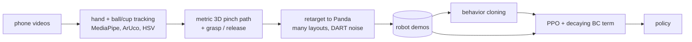

# Robot_arm: a simulated Panda learns to drop a ball in a cup from your phone videos

You record yourself picking up a small ball, moving it over a cup and dropping it in. This project turns those
clips into 3D hand trajectories, retargets them onto a **Franka Panda** arm in **MuJoCo**, trains a
**behavior-cloning** policy on the retargeted demonstrations, and then **fine-tunes it with RL (PPO)** to push
the success rate up. That covers challenge directions 1 and 3.



| | |
|---|---|
| Robot | Franka Emika Panda + parallel gripper ([MuJoCo Menagerie](https://github.com/google-deepmind/mujoco_menagerie), downloaded on first run) |
| Simulator | MuJoCo 3 (CPU); PyTorch for learning (GPU if available) |
| Task | Pick a 4 cm ball, carry it over a cup, drop it in. Ball and cup are placed at random in a 30 × 60 cm area |
| Observation | Arm joints, gripper width, gripper/ball/cup positions (34-D state) |
| Action | Gripper displacement (±1.5 cm per 50 ms step) + open/close |

## Quickstart (no videos needed)

```bash
pip install -e ".[dev]"
pytest                                             # unit + end-to-end tests (~30 s)

python scripts/evaluate.py --policy scripted       # hand-written baseline: should be ~100%
python scripts/view.py --policy scripted           # watch it (needs a display)

# Try the full learning pipeline on synthetic "human" demonstrations:
python scripts/make_synthetic_human.py --n 15
python scripts/retarget_demos.py --human data/processed/human_synthetic
python scripts/train_bc.py
python scripts/train_rl.py --num-envs 16           # about one env per CPU core
python scripts/evaluate.py --policy runs/ppo/policy.pt --videos runs/ppo/videos
```

Rendering videos without a display needs `MUJOCO_GL=egl` (NVIDIA) or `MUJOCO_GL=osmesa`.

## With your own videos

1. `python scripts/make_markers.py`, then print `docs/marker_sheet.pdf` on A4 at 100% scale.
2. Record 10–20 clips following **[docs/RECORDING.md](docs/RECORDING.md)**: a fixed phone, the marker sheet
   on the table, an orange ball and a blue cup.
3. Process them, check the overlays, then train:

```bash
python scripts/process_video.py data/videos/clip01.mp4 --check     # markers + colors OK?
python scripts/process_video.py data/videos/*.mp4                  # -> data/processed/human/
python scripts/retarget_demos.py --human data/processed/human      # -> data/processed/robot_demos.npz
python scripts/train_bc.py --out runs/bc
python scripts/train_rl.py --init runs/bc/policy.pt --out runs/ppo
python scripts/evaluate.py --policy replay:data/processed/human    # retargeted replay, no learning
python scripts/evaluate.py --policy runs/bc/policy.pt
python scripts/evaluate.py --policy runs/ppo/policy.pt --videos runs/ppo/videos
```

`retarget_demos.py` also writes `data/processed/retarget_videos/<clip>.mp4`, which shows your tracked video
next to the robot doing the same motion.

## How it works

**1. Video → 3D human demonstration** (`robot_arm/video/`)
- *Camera.* The four ArUco markers on the A4 sheet give the camera pose and a metric table frame. The focal
  length comes from a single-view calibration on the sheet, with an override.
- *Hand.* MediaPipe gives 21 landmarks in pixels plus metric 3D landmarks centred on the hand. Solving the
  pinhole equations for the hand's translation (a 3×3 least-squares problem) places the hand in 3D. The
  tracked point is the midpoint of the thumb and index tips; the aperture is the distance between them.
- *Depth scale.* Monocular depth is only as good as MediaPipe's guess of your hand size. That error is a single
  factor along the camera rays, so it is fitted once per clip from the grasp: at that moment the pinch point
  must be at the ball. A second anchor (pinch directly over the cup at release) removes what is left.
- *Events.* Lift-off is when the ball starts moving in the image. The grasp is the last closing of the
  aperture before lift-off; the release is the next wide opening.

**2. Retargeting** (`robot_arm/retarget.py`)
- A 2D similarity transform maps your ball and cup positions onto any robot layout. The approach is therefore
  relative to the ball and the drop relative to the cup, and one clip can be replayed on many layouts.
- Heights are shifted so the grasp happens at the simulated ball's centre, and the carried ball always clears
  the rim.
- Only the motion that is faster than the arm can follow is slowed down, so the robot keeps your timing
  elsewhere. The start of the path is bent so it begins at the robot's gripper.
- A closed-loop expert tracks the path:
  - it waits when the arm lags;
  - it follows the ball if it gets nudged;
  - it closes the gripper only when it is around the ball, and opens it when the ball is over the cup.
  Triggering the gripper on the state rather than on your timing avoids a classic BC failure: the policy
  hovers over the cup forever because "pause, then let go" can't be told apart from "pause".
- Rollouts get noise injected into the executed actions while the clean expert actions are recorded (DART), so
  the dataset contains recoveries. Only episodes that end with the ball in the cup are kept.

**3. Learning** (`robot_arm/bc.py`, `robot_arm/ppo.py`)
- *BC.* A Gaussian MLP (3×256) regresses the expert actions. Its exploration std is initialised from the
  residuals.
- *PPO + BC term (DAPG-style).* PPO starts from the BC weights. The critic warms up first with the actor
  frozen, and the loss adds λₖ·BC(demos) with λₖ decaying, so RL can improve on the demos without immediately
  forgetting them.
- *Reward.* The reward is staged and dense (reach → grasp → lift → over the cup), plus 2 per step once the
  ball is in the cup.

## Results


Pipeline check on **15 synthetic human demonstrations** (`make_synthetic_human.py`), evaluated with
`scripts/evaluate.py` on 100 held-out random layouts. These numbers come from this container (4 CPU cores, no
GPU). Re-run the same commands on your own recordings to get your numbers.

| Policy | Success | Steps to success (20 Hz) |
|---|---|---|
| Scripted waypoints (not learned, privileged) | 100% | 74 |
| Replay of retargeted human demos (no learning) | 95% | 128 |
| Behavior cloning (40 epochs on 720 retargeted episodes) | 98% | 121 |
| BC + PPO (60 iterations, 246k env steps, ~10 min on 4 cores) | 98% | **80** |

RL keeps BC's success rate and makes it about 1.5× faster. It learns to move decisively instead of copying the
human's hesitations, which gets close to the hand-tuned scripted speed. On the PPO run's own 50 evaluation
layouts, success went from 96% (BC) to 100%.

Two lessons from building this, both handled in the code:
- **Gripper decisions must depend on the state, not on time.** Retargeted human timing ("hover, then let go")
  made BC hover forever: 0% success. Making the expert release the ball as soon as it is over the cup, and
  upweighting the rare open/close samples in the BC loss, fixed it.
- **PPO on top of a good BC policy needs big batches and small steps.** With about 1k samples per update,
  success degraded as the BC term decayed. About 4k samples per update, a 5e-5 actor learning rate, KL early
  stopping and a BC-term floor made it improve steadily.

## Repository layout

```
robot_arm/
  scene.py, env.py, controller.py   MuJoCo scene (MjSpec), Gymnasium env, differential IK
  scripted.py                       waypoint baseline
  video/                            calibration, tracking, 3D lifting, reconstruction, debug outputs
  synthetic.py                      synthetic human demonstrations
  retarget.py, dataset.py           human -> robot retargeting and dataset generation
  policy.py, bc.py, ppo.py          actor-critic, behavior cloning, PPO fine-tuning
  evaluate.py                       success-rate evaluation and rollout videos
scripts/                            command-line entry points (see above)
docs/RECORDING.md                   how to record the videos
tests/                              tests against synthetic ground truth
```

## Ideas for going further

- Image-based policies: render the `front` camera and swap the state observation for pixels.
- MJX / MuJoCo Playground for GPU-parallel RL, with thousands of environments.
- Retarget the full hand (all 21 landmarks) onto a five-finger hand such as the Unitree G1 with an Inspire
  hand, reusing the same video pipeline.
