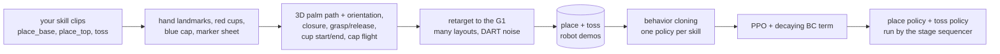
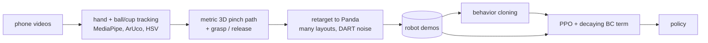

# Robot_arm: robots that learn cup tasks from your phone videos

Two tasks share one pipeline: phone videos of your hand → 3D human demonstrations → retargeting onto a robot
in **MuJoCo** → **behavior cloning** → **RL fine-tuning (PPO)**.

- **[Humanoid cup pyramid](#humanoid-cup-pyramid-unitree-g1)** (current). A **Unitree G1** with Dex3 hands
  builds a pyramid from three red party cups, then pinches a bottle cap off the table and throws it into the top
  cup.
- **[Panda ball in cup](#panda-ball-in-cup-the-original-task)** (the original task). A **Franka Panda** picks up
  a ball and drops it into a cup.

## Humanoid cup pyramid (Unitree G1)


A **Unitree G1** (Dex3 three-finger hands, pelvis fixed) is given three red party cups and a blue bottle cap:

1. it puts two cups mouth-down side by side (A, then B);
2. it puts the third cup mouth-up across them;
3. it pinches the cap off the table and **throws it sideways, along the two base cups**, into the top cup.
   Thrown along them, the cap's push on landing goes the way the top cup is held by both base cups.

The episode succeeds when the cap is in the top cup while the pyramid stands. A collapse afterwards is fine.
The objects match the real ones: cups 12 cm tall, 9 cm across the mouth, 5 cm across the bottom; a 2.8 cm cap
lying flat on the table; releases 5–30 cm from the cup.



### What is learned, and from what

The robot doesn't watch your videos at run time. It sees the simulator's state: joint angles, its hand pose,
each cup's position and mouth direction, the cap's position and velocity, the current stage and its target.
Your videos are turned into robot demonstrations before training.

| Part | How it is obtained |
|---|---|
| Where the cups and the cap are | Simulator state (on a real robot: a camera-based object tracker) |
| Which cup to move next and where it goes | Fixed sequencer: A → B next to A → top cup centred on A and B → throw. The top cup's target follows where A and B actually ended up |
| The arm motion for placing a cup: approach, carry, lowering, letting go | **Learned** (BC, then PPO) from your `place_*` clips, retargeted |
| How the hand is turned while reaching and carrying | **Learned** from your palm orientation; near the cup it blends into the G1's side grasp |
| When to close and open the hand | **Learned**. The demos close when the hand is around the cup and open when the cup stands, so the decision depends on the state, not the clock |
| The throw: release distance, height, flight time, wind-up | **Learned** from your `toss_*` clips, clipped to the range where the G1's throw works; the aim is calibrated in simulation |
| Turning joint targets into torques | MuJoCo position actuators; the hand pose → joints step is damped least-squares IK |

### Quickstart (no videos needed)

```bash
pip install -e ".[dev]"
python scripts/g1_evaluate.py --task full --episodes 20       # scripted experts
python scripts/g1_view.py                                     # watch (needs a display)

# The whole learning pipeline on synthetic human clips:
python scripts/g1_make_synthetic_human.py --n 10              # -> data/processed/human_pyramid_synthetic/
python scripts/g1_retarget_demos.py --human data/processed/human_pyramid_synthetic   # -> g1_place.npz, g1_toss.npz
python scripts/train_bc.py --task g1-place --data data/processed/g1_place.npz --out runs/g1_place_bc \
    --epochs 60 --eval-every 15
python scripts/train_bc.py --task g1-toss --data data/processed/g1_toss.npz --out runs/g1_toss_bc \
    --epochs 150 --eval-every 30
PPO="--num-envs 8 --rollout-steps 512 --minibatch 2048 --actor-lr 2e-5 --target-kl 0.01 --bc-min 0.1"
python scripts/train_rl.py --init runs/g1_place_bc/policy.pt --demos data/processed/g1_place.npz \
    --out runs/g1_place_ppo $PPO --iterations 40 --init-std 0.05
python scripts/train_rl.py --init runs/g1_toss_bc/policy.pt --demos data/processed/g1_toss.npz \
    --out runs/g1_toss_ppo $PPO --iterations 50 --init-std 0.012 --min-log-std -4.8
python scripts/g1_results.py --replay data/processed/human_pyramid_synthetic --episodes 40 \
    --bc runs/g1_place_bc/policy.pt runs/g1_toss_bc/policy.pt \
    --ppo runs/g1_place_ppo/policy.pt runs/g1_toss_ppo/policy.pt
```

### With your own videos

Record short clips of one skill each, following **[docs/RECORDING_PYRAMID.md](docs/RECORDING_PYRAMID.md)**: a
fixed phone at 60 fps, the marker sheet on the table, your red cups and the blue cap. Then:

```bash
python scripts/g1_process_videos.py data/videos_pyramid/toss_01.mp4 --check   # markers + colors OK?
python scripts/g1_process_videos.py data/videos_pyramid/*.mp4                 # -> data/processed/human_pyramid/
python scripts/g1_retarget_demos.py --human data/processed/human_pyramid      # then train as above
```

`g1_retarget_demos.py --videos 2` also renders a few retargeted demos next to the clips' tracking overlays.

### How it works

**Video → human skill demonstration** (`robot_arm/video/skills.py`, `skill_process.py`)
- *Palm pose.* MediaPipe's world landmarks are metric and camera-aligned. The wrist and knuckles give the palm
  frame, and the camera pose from the sheet turns it into the table frame. Finger curl and thumb distance give
  a closure value.
- *Same-colour cups.* All cups are red, so the moved cup is found from what changes. Red only in the first
  (still) second is where it started; red only in the last second is where it went. In between, it is the red
  that isn't a static cup. A standing cup's lowest red pixel is its rim point nearest the camera (just above
  the white rolled lip when mouth down). The two base cups are the two low points of the pyramid's outline. The
  top cup's mouth is the centre of its widest red row, just under its white lip.
- *Depth scale.* The hand's size (and so its depth) is fitted per clip from the grasp: the palm is beside the
  cup it closes on, or the thumb–index point is at the cap.
- *Cap flight.* A tumbling cap's image size says nothing about its depth, but its pixel path does. With gravity
  known, the parabola's curvature in the image fixes the distance. The fit is tied to the thumb–index point at
  the release, which is found by following the parabola back.

**Retargeting** (`robot_arm/humanoid/retarget.py`)
- *Placing.* Your hand path is mapped relative to the cup near the grasp and relative to the target near the
  release, rotated to the robot's grasp heading and scaled by the arm-length ratio. It then gets the robot's
  constraints:
  - the approach slides in along the fingers;
  - the path clears the other cups;
  - the open hand slides back out of the top cup before rising;
  - only motion too fast for the arm is slowed down.
  A closed-loop tracker follows it and triggers the grasp, the final alignment, the lowering and the release
  from the state.
- *Throwing.* Your throw's style becomes the robot's: release distance and height relative to the mouth,
  bearing off the base cups' line, flight time and wind-up. It is clipped to where the G1's throw works
  (`TOSS_BOUNDS`, from simulated sweeps: 10–16 cm from the mouth). The release velocity is ballistic for the
  robot's own release point, and the aim is calibrated per style in simulation. The pinch itself is the
  robot's own, as the Dex3 has three fingers and the cap needs millimetre placement.
- Rollouts get noise on the executed motion (DART) but not during contacts. Every stage that succeeds is kept.

**Learning.** One Gaussian MLP per skill (place, toss) is trained with BC, upweighting the rare open/close
steps and the fast throw steps. It is then fine-tuned with PPO plus a decaying BC term on the skill's own
environment. At run time the sequencer hands each stage to the right policy.
- *Reward.* Potential-based shaping: each step earns the change in staged progress (reach → hold → near the
  target → placed, or held → thrown towards the mouth), and success earns +10. An earlier version paid the
  progress itself every step. PPO found that holding a placed cup until the time ran out paid more than letting
  go, and took the place skill from 100% to 0% success while its return went up.
- *Exploration.* Small and fixed: a std of 0.05 action units for placing and 0.012 for the throw. The BC policy's
  own spread (about 0.13) already drops placing to about 40%, and PPO then learns mostly from failures.

### Results

Pipeline check on **10 synthetic human demos per skill** (`g1_make_synthetic_human.py`). Each cell is 40
held-out layouts (`scripts/g1_results.py`, also written to `runs/g1_results.md`). The numbers come from this
container (4 CPU cores, no GPU). Re-run the same commands on your own recordings to get your numbers.

| Policy | place A | place B | place top | toss | full task |
|---|---|---|---|---|---|
| Scripted experts (hand-written, not learned) | 100% | 100% | 98% | 65% | 78% |
| Retargeted human demos, replayed (no learning) | 100% | 100% | 80% | 52% | 57% |
| BC (one policy per skill) | 100% | 92% | 88% | 57% | 42% |
| BC + PPO | 100% | 98% | **100%** | 62% | **52%** |

- The **full task** chains all four stages with the learned policies and counts only episodes where the cap ends
  up in a standing pyramid.
- The **toss** column starts right after the top cup has been placed, as in the full task. Most of its failures
  (6–10 of 40) are the top cup toppling while the hand leaves it; the rest are caps that miss.
- PPO's gains are in placing the top cup (88% → 100%) and in the full task (42% → 52%).

Training on 4 CPU cores:

| Run | Time |
|---|---|
| Dataset (600 episodes, plus 400 toss-only episodes with `--task-mix toss=1` for the toss policies) | ~1.5 h |
| BC place | 30 min |
| BC toss | 1 h |
| PPO place (40 iterations) | 40 min |
| PPO toss (50 iterations) | 3 h; each toss episode first replays the top-cup placement |

What it took to make RL help here:
- **A shaping reward that can't be farmed.** Paying staged progress every step made "hold the placed cup until
  time runs out" the best policy. Each step now earns only the change in progress.
- **The same start state as the full task.** Toss policies trained from the robot's ready pose knocked the top
  cup over as soon as they took over from the place policy, with the hand still in the cup. BC + PPO on the full
  task went from 18% to 52% once the toss task started at that hand-over.
- **Small exploration noise** (0.05 for placing, 0.012 for the throw). With the noise BC fitted, placing
  succeeded only ~40% of the time and PPO learned mostly from failures.

### Simulation shortcuts and limits, stated plainly

- The pelvis is fixed: the legs stand still and only the waist, the right arm and the right hand move.
- Objects are tracked perfectly (the policy gets their state). A real robot needs a camera-based tracker.
- The cups' walls are 2 mm thick (real ones are about 0.5 mm) because thinner walls make contacts unreliable
  in simulation. Cup mass is 12 g and cap mass 2 g; measure yours and set them in
  `robot_arm/humanoid/config.py`.
- The base cups stand 2 cm apart (mouth to mouth), so the top cup sinks 2–4 cm into the V between their walls
  and is held there. With the mouths touching, the simulated top cup rests on two thin patches of the base
  cups' bottoms, and the push of the opening Dex3 fingers topples it front to back a few seconds later
  (scripted full task: 75% with a 4 mm gap, 90–94% with 2 cm). The window is narrow: at 2.8 cm it falls
  through. (This is about the simulated cups; record your clips the way your real pyramid stands.)
- A top cup counts as standing if it rests within 3 cm of the base cups' midpoint, up to 6 cm lower than their
  tops, and tilts less than 20°.
- **The main failure is the top cup toppling a few seconds after it is let go**, while the hand slides out or the
  throw begins: the opening fingers push it 1–2 cm and it then creeps over on its soft contacts. It happens to
  the scripted experts too, and tuning didn't remove it:
  - snapping the hand open, or finishing the place skill only once the hand is clear, both made the full task
    worse;
  - MuJoCo's no-slip solver stops the creep but triples the simulation time and breaks the cap pinch.
  The success checks count it as a failure, so the numbers above include it.
- The toss task starts where the full task hands over to the throw: the scripted expert has just set the top
  cup on two pre-built base cups and let go, with the hand still around it. The toss policy learns to slide out
  of the cup before reaching for the cap.
- The robot's throw works for releases 10–16 cm from the cup. Your throws from further away (up to 30 cm) are
  pulled into that range: their arc and wind-up are kept, their distance is not.
- The cap starts at roughly the same spot each episode (±1.5 cm), as in your setup video.

## Panda ball in cup (the original task)

You record yourself picking up a small ball, moving it over a cup and dropping it in. This project turns those
clips into 3D hand trajectories, retargets them onto a **Franka Panda** arm in **MuJoCo**, trains a
**behavior-cloning** policy on the retargeted demonstrations, and then **fine-tunes it with RL (PPO)** to push
the success rate up. That covers challenge directions 1 and 3.



| | |
|---|---|
| Robot | Franka Emika Panda + parallel gripper ([MuJoCo Menagerie](https://github.com/google-deepmind/mujoco_menagerie), downloaded on first run) |
| Simulator | MuJoCo 3 (CPU); PyTorch for learning (GPU if available) |
| Task | Pick a 4 cm ball, carry it over a cup, drop it in. Ball and cup are placed at random in a 30 × 60 cm area |
| Observation | Arm joints, gripper width, gripper/ball/cup positions (34-D state) |
| Action | Gripper displacement (±1.5 cm per 50 ms step) + open/close |

### Quickstart (no videos needed)

```bash
pip install -e ".[dev]"
pytest                                             # unit + end-to-end tests (~30 s)

python scripts/evaluate.py --policy scripted       # hand-written baseline: should be ~100%
python scripts/view.py --policy scripted           # watch it (needs a display)

# Try the full learning pipeline on synthetic "human" demonstrations:
python scripts/make_synthetic_human.py --n 15
python scripts/retarget_demos.py --human data/processed/human_synthetic
python scripts/train_bc.py
python scripts/train_rl.py --num-envs 16           # about one env per CPU core
python scripts/evaluate.py --policy runs/ppo/policy.pt --videos runs/ppo/videos
```

Rendering videos without a display needs `MUJOCO_GL=egl` (NVIDIA) or `MUJOCO_GL=osmesa`.

### With your own videos

1. `python scripts/make_markers.py`, then print `docs/marker_sheet.pdf` on A4 at 100% scale.
2. Record 10–20 clips following **[docs/RECORDING.md](docs/RECORDING.md)**: a fixed phone, the marker sheet
   on the table, an orange ball and a blue cup.
3. Process them, check the overlays, then train:

```bash
python scripts/process_video.py data/videos/clip01.mp4 --check     # markers + colors OK?
python scripts/process_video.py data/videos/*.mp4                  # -> data/processed/human/
python scripts/retarget_demos.py --human data/processed/human      # -> data/processed/robot_demos.npz
python scripts/train_bc.py --out runs/bc
python scripts/train_rl.py --init runs/bc/policy.pt --out runs/ppo
python scripts/evaluate.py --policy replay:data/processed/human    # retargeted replay, no learning
python scripts/evaluate.py --policy runs/bc/policy.pt
python scripts/evaluate.py --policy runs/ppo/policy.pt --videos runs/ppo/videos
```

`retarget_demos.py` also writes `data/processed/retarget_videos/<clip>.mp4`, which shows your tracked video
next to the robot doing the same motion.

### How it works

**1. Video → 3D human demonstration** (`robot_arm/video/`)
- *Camera.* The four ArUco markers on the A4 sheet give the camera pose and a metric table frame. The focal
  length comes from a single-view calibration on the sheet, with an override.
- *Hand.* MediaPipe gives 21 landmarks in pixels plus metric 3D landmarks centred on the hand. Solving the
  pinhole equations for the hand's translation (a 3×3 least-squares problem) places the hand in 3D. The
  tracked point is the midpoint of the thumb and index tips; the aperture is the distance between them.
- *Depth scale.* Monocular depth is only as good as MediaPipe's guess of your hand size. That error is a single
  factor along the camera rays, so it is fitted once per clip from the grasp: at that moment the pinch point
  must be at the ball. A second anchor (pinch directly over the cup at release) removes what is left.
- *Events.* Lift-off is when the ball starts moving in the image. The grasp is the last closing of the
  aperture before lift-off; the release is the next wide opening.

**2. Retargeting** (`robot_arm/retarget.py`)
- A 2D similarity transform maps your ball and cup positions onto any robot layout. The approach is therefore
  relative to the ball and the drop relative to the cup, and one clip can be replayed on many layouts.
- Heights are shifted so the grasp happens at the simulated ball's centre, and the carried ball always clears
  the rim.
- Only the motion that is faster than the arm can follow is slowed down, so the robot keeps your timing
  elsewhere. The start of the path is bent so it begins at the robot's gripper.
- A closed-loop expert tracks the path:
  - it waits when the arm lags;
  - it follows the ball if it gets nudged;
  - it closes the gripper only when it is around the ball, and opens it when the ball is over the cup.
  Triggering the gripper on the state rather than on your timing avoids a classic BC failure: the policy
  hovers over the cup forever because "pause, then let go" can't be told apart from "pause".
- Rollouts get noise injected into the executed actions while the clean expert actions are recorded (DART), so
  the dataset contains recoveries. Only episodes that end with the ball in the cup are kept.

**3. Learning** (`robot_arm/bc.py`, `robot_arm/ppo.py`)
- *BC.* A Gaussian MLP (3×256) regresses the expert actions. Its exploration std is initialised from the
  residuals.
- *PPO + BC term (DAPG-style).* PPO starts from the BC weights. The critic warms up first with the actor
  frozen, and the loss adds λₖ·BC(demos) with λₖ decaying, so RL can improve on the demos without immediately
  forgetting them.
- *Reward.* The reward is staged and dense (reach → grasp → lift → over the cup), plus 2 per step once the
  ball is in the cup.

### Results


Pipeline check on **15 synthetic human demonstrations** (`make_synthetic_human.py`), evaluated with
`scripts/evaluate.py` on 100 held-out random layouts. These numbers come from this container (4 CPU cores, no
GPU). Re-run the same commands on your own recordings to get your numbers.

| Policy | Success | Steps to success (20 Hz) |
|---|---|---|
| Scripted waypoints (not learned, privileged) | 100% | 74 |
| Replay of retargeted human demos (no learning) | 95% | 128 |
| Behavior cloning (40 epochs on 720 retargeted episodes) | 98% | 121 |
| BC + PPO (60 iterations, 246k env steps, ~10 min on 4 cores) | 98% | **80** |

RL keeps BC's success rate and makes it about 1.5× faster. It learns to move decisively instead of copying the
human's hesitations, which gets close to the hand-tuned scripted speed. On the PPO run's own 50 evaluation
layouts, success went from 96% (BC) to 100%.

Two lessons from building this, both handled in the code:
- **Gripper decisions must depend on the state, not on time.** Retargeted human timing ("hover, then let go")
  made BC hover forever: 0% success. Making the expert release the ball as soon as it is over the cup, and
  upweighting the rare open/close samples in the BC loss, fixed it.
- **PPO on top of a good BC policy needs big batches and small steps.** With about 1k samples per update,
  success degraded as the BC term decayed. About 4k samples per update, a 5e-5 actor learning rate, KL early
  stopping and a BC-term floor made it improve steadily.

## Repository layout

```
robot_arm/
  scene.py, env.py, controller.py   Panda: MuJoCo scene (MjSpec), Gymnasium env, differential IK
  scripted.py, synthetic.py         Panda: waypoint baseline, synthetic human demonstrations
  retarget.py, dataset.py           Panda: human -> robot retargeting and dataset generation
  humanoid/                         G1 cup pyramid:
    config.py, scene.py               cups, cap, table and layout; the G1 scene with the pelvis fixed
    controller.py, envs.py            damped least-squares IK + Dex3 grasp synergies; place / toss / full envs
    objects.py, scripted.py           pyramid geometry and success checks; scripted place and throw experts
    retarget.py, dataset.py           human skill demos -> G1 (place tracker, throw styles, aim calibration)
    synthetic.py, evaluate.py         synthetic human skill clips; stage sequencer and evaluation
  video/                            calibration, hand and object tracking, 3D lifting, reconstruction
                                    (skills.py, skill_process.py: the per-skill clips of the pyramid task)
  tasks.py                          task registry (panda, g1-place, g1-toss) for training and evaluation
  policy.py, bc.py, ppo.py          actor-critic, behavior cloning, PPO fine-tuning (all tasks)
  evaluate.py                       Panda success-rate evaluation and rollout videos
scripts/                            command-line entry points (g1_* for the humanoid)
docs/RECORDING.md                   how to record the Panda videos
docs/RECORDING_PYRAMID.md           how to record the pyramid skill clips
tests/                              tests against synthetic ground truth
```

## Ideas for going further

- Image-based policies: render a camera and swap the state observation for pixels, which a real robot needs.
- Free the G1's pelvis and keep its balance with a whole-body controller while it reaches and throws.
- MJX / MuJoCo Playground for GPU-parallel RL, with thousands of environments.
- Retarget all 21 hand landmarks onto the Dex3 fingers instead of the grasp synergies.
